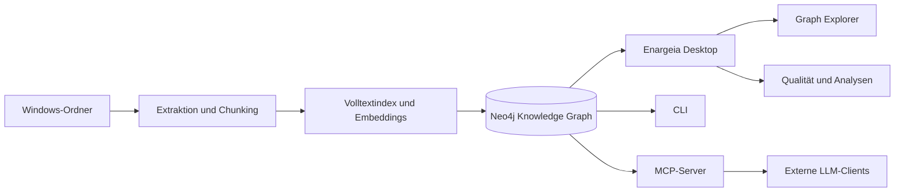

<div align="center">
  

  <p><strong>Unternehmenswissen als vernetzter Graph.</strong></p>
  <p>Windows-Desktop-Anwendung zum Aufbau, zur Qualitätssicherung und zur Analyse eines Unternehmens-Knowledge-Graphen.</p>

  <p>
    
    
    
  </p>
</div>

## Überblick

**Enargeia** baut aus ausgewählten Windows-Verzeichnissen einen durch Quellen belegten Wissensgraphen in Neo4j auf. Dokumente und Textabschnitte werden mit Metadaten, Entitäten und Beziehungen verknüpft. So lassen sich Strukturen, Abhängigkeiten und mögliche Wissenslücken nachvollziehen, statt Dateien nur als isolierte Einträge zu verwalten.

Die Desktop-Oberfläche konzentriert sich bewusst auf den **Aufbau, die Verwaltung, die Qualitätssicherung und die Analyse** des Graphen. Sie enthält keine Chat- oder RAG-Oberfläche. Inhaltliche Suche und Kontextzugriff stehen über die CLI und den MCP-Server für externe LLM-Clients zur Verfügung.

## Funktionen

<table>
  <tr>
    <td width="50%" valign="top">
      <h3>Datenquellen &amp; Indexierung</h3>
      <ul>
        <li>Windows-Ordner als Datenquellen registrieren</li>
        <li>Inkrementelle Verarbeitung neuer und geänderter Dateien</li>
        <li>Text-Extraktion für gängige Office-, PDF-, Text-, Code- und Tabellenformate sowie optionale Bildextraktion</li>
        <li>Konfigurierbares Chunking, Dateigrößen- und Chunk-Limits</li>
        <li>Kontrollierter Neuaufbau oder Entfernung eines einzelnen Roots</li>
      </ul>
    </td>
    <td width="50%" valign="top">
      <h3>Knowledge Graph</h3>
      <ul>
        <li>Neo4j als zentrale Graphdatenbank</li>
        <li>Quellen- und Evidenzbeziehungen zur Nachvollziehbarkeit</li>
        <li>Lokale Embeddings über FastEmbed und ONNX Runtime</li>
        <li>3D Graph Explorer in einem separaten WebView2-Fenster</li>
        <li>Optionale Neo4j Graph Data Science (GDS)-Analysen</li>
      </ul>
    </td>
  </tr>
  <tr>
    <td valign="top">
      <h3>Qualität &amp; Graph-Intelligenz</h3>
      <ul>
        <li>Deterministische Graphanalysen mit Cypher</li>
        <li>Vorschläge für mögliche Beziehungen mit nachvollziehbaren Quellen</li>
        <li>Beziehungsvorschläge akzeptieren, zurückweisen oder zurückstellen</li>
        <li>Optionale LLM-gestützte Entitätsextraktion</li>
        <li>Optionale Community-Zusammenfassungen und globale Suche</li>
      </ul>
    </td>
    <td valign="top">
      <h3>CLI &amp; MCP</h3>
      <ul>
        <li>Hybrid-Suche aus Volltext-, Embedding- und Graphkontext</li>
        <li>Dateikontext und verwandte Dateien abfragen</li>
        <li>Graphstatistiken und Analysebefunde abrufen</li>
        <li>Such- und Graphwerkzeuge über MCP externen LLM-Clients bereitstellen</li>
        <li>Integrierter Systemtest für Verbindungen und Embeddings</li>
      </ul>
    </td>
  </tr>
</table>

## Architektur auf einen Blick



Die Graphdatenbank ist das zentrale Wissens-Backend. Die Desktop-Anwendung dient der operativen Verwaltung und strukturellen Exploration. Inhaltliche Fragen lassen sich über die Suchfunktionen der CLI oder die MCP-Werkzeuge an ein verbundenes LLM geben.

## Bereiche der Desktop-Anwendung

| Bereich | Zweck |
|---|---|
| **Übersicht** | Graphbestand, Datenabdeckung und Status im Blick behalten |
| **Datenquellen** | Roots registrieren, Scans starten und Indexierungsaktivitäten überwachen |
| **Graph Explorer** | Knoten, Kanten, Dateien und Quellenbeziehungen strukturell untersuchen |
| **Qualität & Beziehungen** | Evidenz und Beziehungsvorschläge prüfen und kontrolliert entscheiden |
| **Graph-Analysen** | Struktur, Abdeckung und Beziehungen mit Cypher und optional GDS analysieren |
| **System & MCP** | Datenbank- und Embedding-Verbindungen prüfen, Konfiguration ansehen und externe Anbindung vorbereiten |

## Laufzeitoptionen

Die Komponenten können unabhängig voneinander lokal betrieben oder mit vorhandenen Diensten verbunden werden.

| Komponente | Standard bzw. integrierter Weg | Alternativen |
|---|---|---|
| Graphdatenbank | Lokale Neo4j-Instanz | Externe Neo4j-Instanz oder Neo4j Aura |
| Embeddings | FastEmbed / ONNX Runtime, lokal | Vorhandenes Ollama oder OpenAI-kompatible Embedding-API |
| LLM | Deaktiviert | Lokales/externes Ollama oder OpenAI-kompatible API |
| Graphanalyse | Neo4j Cypher | Optional Neo4j Graph Data Science |
| Inhaltssuche | CLI und MCP | Einbindung in externe LLM- oder Agenten-Workflows |

LLM-Funktionen sind optional. Ohne externe KI lassen sich Datenquellen indexieren, der Graph verwalten und strukturbezogene Analysen durchführen. Automatisch erzeugte Entitäten, Zusammenfassungen und Beziehungsvorschläge sind Hilfsmittel und sollten anhand ihrer Quellen fachlich geprüft werden.

## Erste Einrichtung unter Windows

### Vorgefertigte Installation

Wenn für die gewünschte Version ein Windows-Installer veröffentlicht wurde, verwende das zugehörige Installationspaket. Beim ersten Start öffnet sich der Setup-Assistent. Dort wählst du pro Komponente zwischen lokaler Bereitstellung und externem Dienst und führst anschließend den Systemtest aus.

### Datenquellen einrichten

1. Enargeia starten und den Setup-Assistenten abschließen.
2. Im Bereich **Datenquellen** einen oder mehrere Ordner registrieren.
3. Den ersten Scan starten.
4. Warten, bis Extraktion und Indexierung abgeschlossen sind.
5. Im Graph Explorer den Aufbau und die Quellenbeziehungen prüfen.
6. Bei Bedarf Beziehungsvorschläge bewerten oder Graph-Analysen ausführen.

Das lokale Embedding-Modell wird nicht in den Installer eingebettet. Es wird bei Bedarf heruntergeladen und im Benutzerprofil zwischengespeichert. Beim ersten Download sind Internetzugriff und ausreichend freier Speicherplatz nötig.

## Suche über CLI

Die CLI kann zum Beispiel nach einer ersten Indexierung über dieselbe Konfiguration wie die Desktop-Anwendung verwendet werden:

```powershell
# Verzeichnis einlesen oder aktualisieren
.\.venv\Scripts\enargeia-cli.exe scan "D:\Wissensbasis"

# Hybrid-Suche durchführen
.\.venv\Scripts\enargeia-cli.exe search "Kundenanforderungen an die Produktfreigabe"

# Mit einer Datei verbundene Dateien finden
.\.venv\Scripts\enargeia-cli.exe related "D:\Wissensbasis\Projekt\Anforderungen.docx"

# Graphstatistiken und Verbindungen prüfen
.\.venv\Scripts\enargeia-cli.exe stats
.\.venv\Scripts\enargeia-cli.exe doctor --embedding
```

Weitere Befehle umfassen unter anderem `file`, `graph-capabilities`, `analyze-graph`, `link-candidates` und `review-link-candidate`. Mit `--help` lassen sich Parameter und Optionen anzeigen. Passe Beispielpfade an deine Umgebung an.

## MCP-Integration

Enargeia stellt über einen MCP-Server Werkzeuge für Such- und Kontextzugriff, verwandte Dateien, Graphstatistiken, Analysebefunde und die Verwaltung von Beziehungsvorschlägen bereit. Der MCP-Prozess wird vom jeweiligen MCP-Client gestartet und verwendet die konfigurierte Enargeia-Laufzeit.

Der Server kann aus der eingerichteten Entwicklungsumgebung über Python gestartet werden:

```powershell
.\.venv\Scripts\python.exe -m winkg.mcp_server
```

Der MCP-Client muss den Befehl mit dem passenden Python-Interpreter und dem Argument `-m winkg.mcp_server` starten können. Die konkreten Einstellungen unterscheiden sich je nach MCP-Host.

## Datenschutz und Speicherorte

- Bei lokaler Neo4j-Datenbank, lokalen Embeddings und deaktiviertem externem LLM können Dokumentinhalte vollständig lokal verarbeitet werden.
- Bei Nutzung externer Datenbanken, Embedding-APIs oder LLMs werden die jeweils übertragenen Daten durch den betreffenden Dienst verarbeitet. Prüfe dessen Datenschutz- und Nutzungsbedingungen.
- Enargeia verändert die Quelldateien nicht; es speichert extrahierte Inhalte und Graphdaten separat.
- Scanne nur Verzeichnisse, für die du die nötigen Berechtigungen besitzt, und prüfe vorab, ob sie sensible Informationen enthalten.

Im installierten Windows-Betrieb werden Konfiguration, Modellcache, Laufzeitdaten und Logs standardmäßig im Benutzerprofil gespeichert:

| Inhalt | Speicherort |
|---|---|
| Anwendungsdaten | `%LOCALAPPDATA%\Enargeia` |
| Konfiguration | `%LOCALAPPDATA%\Enargeia\config\settings.env` |
| Lokale Modelle | `%LOCALAPPDATA%\Enargeia\models` |
| Logs | `%LOCALAPPDATA%\Enargeia\logs` |

Diese Verzeichnisse liegen außerhalb des Programmordners und sind daher von den eigentlichen Build-Artefakten getrennt. Bei Neuinstallation oder Deinstallation sollten Datenordner nur bewusst und nach einer Sicherung entfernt werden.

## Systemvoraussetzungen

### Laufende Anwendung

- Windows 10 oder neuer, 64 Bit
- Freier Speicherplatz für Datenbank, Graphindex und bei lokaler Embedding-Nutzung das Modell
- Internetzugriff für die erstmalige Bereitstellung noch nicht vorhandener Laufzeitkomponenten oder Modelle
- Leseberechtigung für die gewählten Quelldaten

### Entwicklung und Windows-Build

- Windows x64
- Python 3.10 bis 3.13 (64 Bit)
- Inno Setup, wenn zusätzlich zum PyInstaller-Programmordner ein `Setup.exe` erzeugt werden soll
- Für die 3D-Ansicht eine funktionierende WebView2-Umgebung

## Entwicklung aus dem Quellcode

Die Anwendung kann direkt aus der Python-Umgebung gestartet werden. Normale Änderungen an Python-Code oder UI erfordern keinen Installer-Build.

```powershell
# Entwicklungsumgebung mit GUI, lokalen Embeddings, MCP, Tests und Packaging einrichten
.\setup_windows.bat

# Desktop-GUI starten
.\run_gui.bat
```

Die Entwicklungsinstallation legt eine lokale `.venv` an. Der Setup-Assistent erscheint beim ersten Start, wenn noch keine Konfiguration vorhanden ist.

### Tests ausführen

```powershell
.\.venv\Scripts\python.exe -m pytest
```

### Windows-Release bauen

```powershell
Set-ExecutionPolicy -Scope Process Bypass
.\packaging\windows\build_windows.ps1
```

Das Build-Skript nutzt eine getrennte Umgebung `.venv-packaging`, installiert festgelegte Laufzeitabhängigkeiten, prüft Flet-/FastEmbed-/ONNX-Voraussetzungen und kontrolliert, ob die benötigten nativen ONNX-Dateien im PyInstaller-Bundle enthalten sind. Das Modell selbst wird nicht mitgepackt. Ohne installiertes Inno Setup werden die PyInstaller-Dateien in `dist` erstellt; der Installer wird erst mit `ISCC.exe` generiert.

### Relevante Projektstruktur

```text
assets/branding/                 Corporate-Design-Quellen und Installer-Grafiken
packaging/windows/               PyInstaller-Einstiege, Build-Skript und Inno Setup
src/winkg/                       Anwendung, Indexierung, Graphlogik, CLI und MCP
src/winkg/ui/                    UI-Komponenten, Theme und 3D-Graph-Oberfläche
tests/                           Funktions- und Regressionstests
pyproject.toml                   Version, Abhängigkeiten und Entry Points
```

## Enargeia Corporate Design

Die Marke visualisiert Unternehmenswissen als Netzwerk: Orbitlinien stehen für Beziehungen, Knoten für Informationen und der leuchtende Kern für Erkenntnis. Der Claim lautet **WISSEN VERBINDET**.

### Farbpalette

| Funktion | Farbe | HEX |
|---|---|---|
| Primärer Hintergrund | Deep Navy | `#071326` |
| Sekundäre Flächen | Navy Surface | `#0B1C36` |
| Primäraktionen und Fokus | Electric Blue | `#1677FF` |
| Graph-Knoten und Verbindungen | Graph Cyan | `#11C5E8` |
| Sekundäre Graphakzente | Galaxy Violet | `#8057F5` |
| Primärtext auf dunklen Flächen | Off White | `#F4F8FF` |
| Sekundärtext | Muted Blue Grey | `#91A9C8` |
| Erfolgsmeldungen | Success Green | `#31D27C` |

**Typografie:** Inter als Primärschrift; unter Windows Segoe UI, danach Arial/sans-serif als Fallback.

Die editierbaren SVG-Originale, PNG-Exporte, Windows-Icons, Installer-Banner, Splash- und Abschlussgrafiken liegen unter [`assets/branding/Enargeia_Corporate_Design`](assets/branding/Enargeia_Corporate_Design). Die vollständigen Markenregeln stehen im [Corporate Design Guide](assets/branding/Enargeia_Corporate_Design/brand/Corporate_Design_Guide.md).

### Grundregeln

- Logos nicht stauchen oder drehen und ihre Farben nicht verändern.
- Auf dunklen Flächen die Variante für dunkle Hintergründe, auf hellen Flächen die passende helle Variante verwenden.
- Um das Zeichen ausreichend Freiraum lassen und den Kontrast der Schrift sicherstellen.

## Fehlerbehebung

### Das lokale Embedding-Modell lässt sich nicht initialisieren

1. Prüfe, ob der erste Modell-Download abgeschlossen ist und Internetzugriff besteht.
2. Prüfe Schreibrechte und freien Speicherplatz unter `%LOCALAPPDATA%\Enargeia\models`.
3. Öffne **System & MCP** und führe den Systemtest erneut aus.
4. Wenn der Fehler bleibt, sichere die zum Fehlerzeitpunkt gehörenden Logs aus `%LOCALAPPDATA%\Enargeia\logs`.

### Neo4j ist nicht erreichbar

- Bei einer lokalen Bereitstellung auf die abgeschlossene Initialisierung warten und anschließend den Systemtest ausführen.
- Bei einer externen Verbindung URI, Datenbanknamen und Zugangsdaten prüfen.
- Sicherstellen, dass die ausgewählte Datenbank vom Rechner erreichbar ist.

### Wenige oder keine Ergebnisse

- Prüfen, ob die betreffende Datenquelle erfolgreich gescannt wurde.
- Dateiformat und Leseberechtigungen kontrollieren.
- Nach Änderungen in den Quelldateien einen weiteren Scan ausführen.
- Bei der Suche über CLI oder MCP sowohl Fachbegriffe als auch alternative Formulierungen testen.

## Projektstatus und Lizenz

Die Projektversion ist **1.2.1**. Sie wird in `pyproject.toml`, `src/winkg/__init__.py` und der Windows-Installer-Konfiguration geführt.
