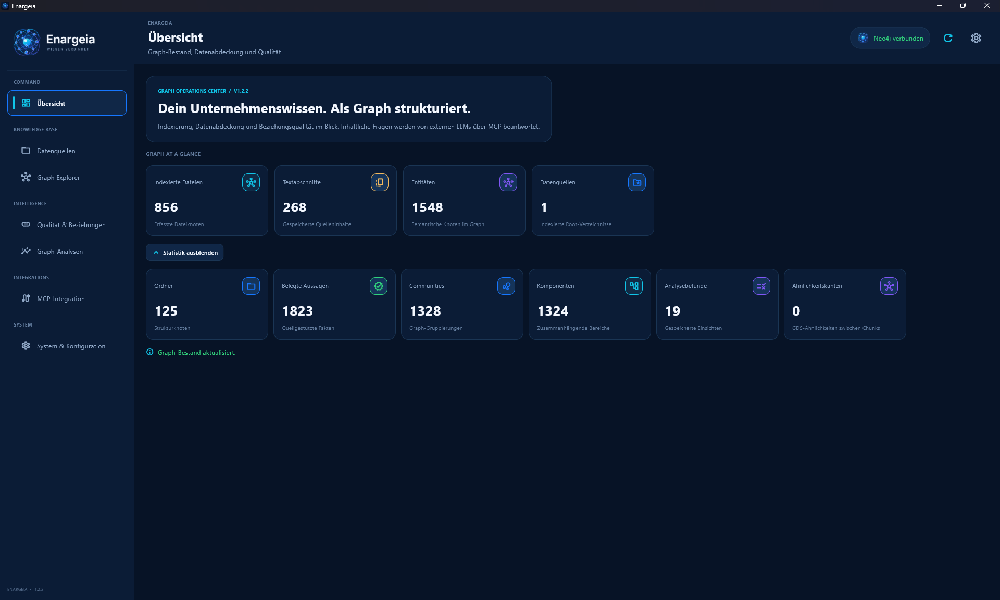
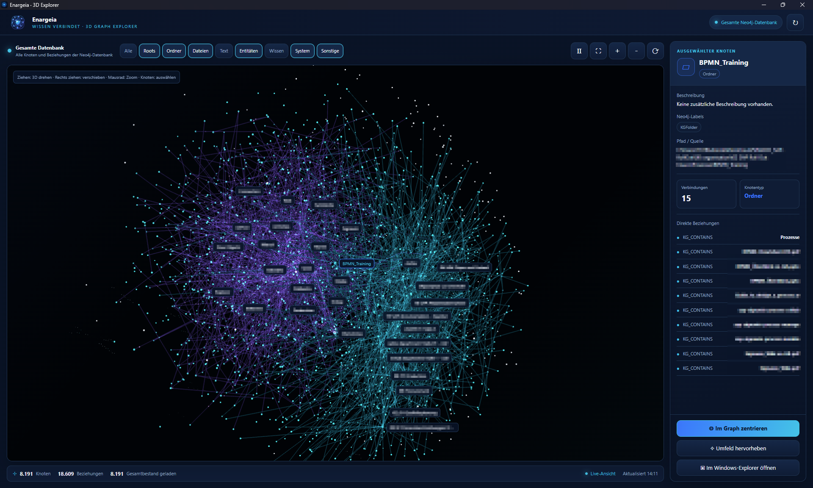
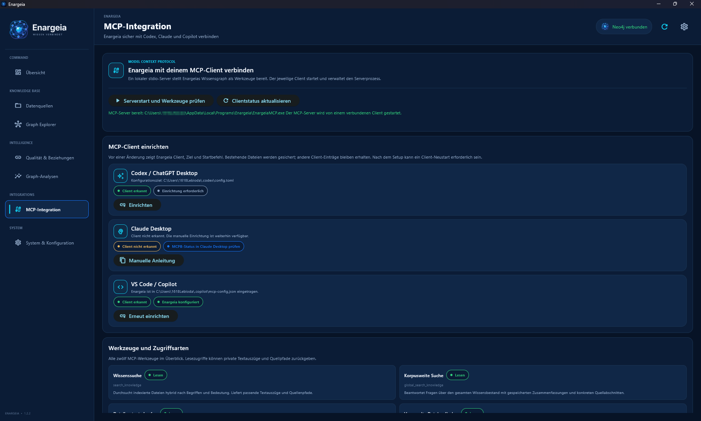
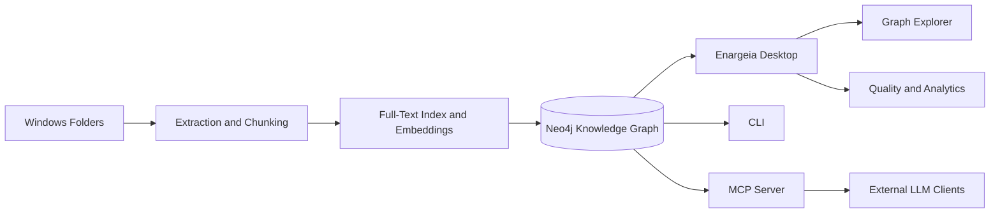

<div align="center">
  

  <p><strong>Company knowledge as a connected graph.</strong></p>
  <p>Windows desktop application for building, quality-assuring, and analyzing a company knowledge graph.</p>

  <p>
    
    
    
  </p>
</div>

## Overview

**Enargeia** builds a source-backed knowledge graph in Neo4j from selected Windows directories. Documents and text chunks are linked with metadata, entities, and relationships. This makes it possible to trace structures, dependencies, and potential knowledge gaps instead of treating files as isolated entries.

The desktop interface deliberately focuses on **building, managing, quality-assuring, and analyzing** the graph. It does not include a chat or RAG interface. Content search and context retrieval are available through the CLI and MCP server for external LLM clients.

## Screenshots
  <p>
      
      
      
  </p>

## Features

<table>
  <tr>
    <td width="50%" valign="top">
      <h3>Data Sources &amp; Indexing</h3>
      <ul>
        <li>Register Windows folders as data sources</li>
        <li>Incrementally process new and changed files</li>
        <li>Extract text from common Office, PDF, text, code, and spreadsheet formats, with optional image extraction</li>
        <li>Configurable chunking, file-size limits, and chunk limits</li>
        <li>Controlled rebuild or removal of an individual root</li>
      </ul>
    </td>
    <td width="50%" valign="top">
      <h3>Knowledge Graph</h3>
      <ul>
        <li>Neo4j as the central graph database</li>
        <li>Source and evidence relationships for traceability</li>
        <li>Local embeddings via FastEmbed and ONNX Runtime</li>
        <li>3D Graph Explorer in a separate WebView2 window</li>
        <li>Optional Neo4j Graph Data Science (GDS) analytics</li>
      </ul>
    </td>
  </tr>
  <tr>
    <td valign="top">
      <h3>Quality &amp; Graph Intelligence</h3>
      <ul>
        <li>Deterministic graph analyses using Cypher</li>
        <li>Suggestions for potential relationships with traceable sources</li>
        <li>Accept, reject, or defer relationship suggestions</li>
        <li>Optional LLM-assisted entity extraction</li>
        <li>Optional community summaries and global search</li>
      </ul>
    </td>
    <td valign="top">
      <h3>CLI &amp; MCP</h3>
      <ul>
        <li>Hybrid search combining full-text, embedding, and graph context</li>
        <li>Retrieve file context and related files</li>
        <li>Access graph statistics and analysis findings</li>
        <li>Expose search and graph tools to external LLM clients through MCP</li>
        <li>Built-in system checks for connections and embeddings</li>
      </ul>
    </td>
  </tr>
</table>

## Architecture at a Glance



The graph database is the central knowledge backend. The desktop application is used for operational management and structural exploration. Content-related questions can be passed to a connected LLM through the CLI's search functions or MCP tools.

## Desktop Application Areas

| Area | Purpose |
|---|---|
| **Overview** | Monitor graph inventory, data coverage, and status |
| **Data Sources** | Register roots, start scans, and monitor indexing activity |
| **Graph Explorer** | Explore nodes, edges, files, and source relationships structurally |
| **Quality & Relationships** | Review evidence and relationship suggestions and make controlled decisions |
| **Graph Analytics** | Analyze structure, coverage, and relationships using Cypher and optional GDS |
| **System & MCP** | Check database and embedding connections, view configuration, and prepare external integrations |

## Runtime Options

Components can be run locally and independently or connected to existing services.

| Component | Default or Integrated Option | Alternatives |
|---|---|---|
| Graph database | Local Neo4j instance | External Neo4j instance or Neo4j Aura |
| Embeddings | Local FastEmbed / ONNX Runtime | Existing Ollama instance or OpenAI-compatible embedding API |
| LLM | Disabled | Local or external Ollama, or an OpenAI-compatible API |
| Graph analytics | Neo4j Cypher | Optional Neo4j Graph Data Science |
| Content search | CLI and MCP | Integration into external LLM or agent workflows |

LLM features are optional. Data sources can be indexed, the graph can be managed, and structural analyses can be performed without external AI services. Automatically generated entities, summaries, and relationship suggestions are aids and should be reviewed against their source evidence.

## Getting Started on Windows

### Prebuilt Installer

If a Windows installer has been published for the version you want, use that installation package. The setup wizard opens on first launch. For each component, choose between a local deployment and an external service, then run the system check.

### Set Up Data Sources

1. Launch Enargeia and complete the setup wizard.
2. In **Data Sources**, register one or more folders.
3. Start the first scan.
4. Wait for extraction and indexing to finish.
5. Review the graph structure and source relationships in Graph Explorer.
6. Evaluate relationship suggestions or run graph analyses as needed.

The local embedding model is not bundled in the installer. It is downloaded when needed and cached in the user profile. The first download requires internet access and sufficient free disk space.

## Search via the CLI

After an initial index has been created, the CLI can use the same configuration as the desktop application. For example:

```powershell
# Scan or update a directory
.\.venv\Scripts\enargeia-cli.exe scan "D:\KnowledgeBase"

# Run a hybrid search
.\.venv\Scripts\enargeia-cli.exe search "Customer requirements for product approval"

# Find files related to a given file
.\.venv\Scripts\enargeia-cli.exe related "D:\KnowledgeBase\Project\Requirements.docx"

# Check graph statistics and connections
.\.venv\Scripts\enargeia-cli.exe stats
.\.venv\Scripts\enargeia-cli.exe doctor --embedding
```

Other commands include `file`, `graph-capabilities`, `analyze-graph`, `link-candidates`, and `review-link-candidate`. Use `--help` to display available parameters and options. Adjust the example paths to match your environment.

## MCP Integration

Enargeia provides an MCP server with tools for search and context retrieval, related files, graph statistics, analysis findings, and managing relationship suggestions. The MCP process is started by the MCP client and uses the configured Enargeia runtime.

In a configured development environment, the server can be started with Python:

```powershell
.\.venv\Scripts\python.exe -m winkg.mcp_server
```

The MCP client must be able to run this command with the appropriate Python interpreter and the argument `-m winkg.mcp_server`. The exact settings depend on the MCP host.

## Privacy and Data Locations

- With a local Neo4j database, local embeddings, and external LLM features disabled, document content can be processed entirely locally.
- When external databases, embedding APIs, or LLMs are used, the relevant service processes the data sent to it. Review that service's privacy policy and terms of use.
- Enargeia does not modify the source files; extracted content and graph data are stored separately.
- Only scan directories you are authorized to access, and check for sensitive information before processing them.

In an installed Windows environment, configuration, model cache, runtime data, and logs are stored in the user profile by default:

| Content | Location |
|---|---|
| Application data | `%LOCALAPPDATA%\Enargeia` |
| Configuration | `%LOCALAPPDATA%\Enargeia\config\settings.env` |
| Local models | `%LOCALAPPDATA%\Enargeia\models` |
| Logs | `%LOCALAPPDATA%\Enargeia\logs` |

`EXTRACTION_CACHE_RETENTION_DAYS` controls how long extraction-cache entries are
kept (default: 90 days). Set it to `0` to disable cache cleanup; negative values
are invalid.

These directories are outside the program folder and are separate from the build artifacts. When reinstalling or uninstalling the application, remove data directories only deliberately and after making a backup.

## System Requirements

### Running the Application

- Windows 10 or later, 64-bit
- Free disk space for the database, graph index, and the model when using local embeddings
- Internet access to download runtime components or models that are not already available locally
- Read permissions for the selected source data

### Development and Windows Builds

- Windows x64
- Python 3.10 to 3.13 (64-bit)
- Inno Setup if you want to create a `Setup.exe` in addition to the PyInstaller application directory
- A working WebView2 environment for the 3D view

## Developing from Source

The application can be started directly from the Python environment. Normal changes to Python code or the UI do not require an installer build.

```powershell
# Set up the development environment with GUI, local embeddings, MCP, tests, and packaging
.\setup_windows.bat

# Start the desktop GUI
.\run_gui.bat
```

The development setup creates a local `.venv`. The setup wizard appears on first launch if no configuration exists yet.

### Run Tests

```powershell
.\.venv\Scripts\python.exe -m pytest
```

### Build a Windows Release

```powershell
Set-ExecutionPolicy -Scope Process Bypass
.\packaging\windows\build_windows.ps1
```

The build script uses a separate `.venv-packaging` environment, installs pinned runtime dependencies, checks Flet/FastEmbed/ONNX prerequisites, and verifies that the required native ONNX files are included in the PyInstaller bundle. The model itself is not bundled. If Inno Setup is not installed, the PyInstaller files are created in `dist`; the installer is generated only when `ISCC.exe` is available.

### Relevant Project Structure

```text
assets/branding/                 Corporate design source files and installer artwork
packaging/windows/               PyInstaller entry points, build script, and Inno Setup files
src/winkg/                       Application, indexing, graph logic, CLI, and MCP
src/winkg/ui/                    UI components, theme, and 3D graph interface
tests/                           Functional and regression tests
pyproject.toml                   Version, dependencies, and entry points
```

### Basic Guidelines

- Do not stretch or rotate logos or change their colors.
- Use the version designed for dark backgrounds on dark surfaces and the appropriate light-background version on light surfaces.
- Leave sufficient clear space around the mark and maintain adequate text contrast.

## Troubleshooting

### The Local Embedding Model Fails to Initialize

1. Check that the initial model download has completed and that internet access is available.
2. Check write permissions and free disk space under `%LOCALAPPDATA%\Enargeia\models`.
3. Open **System & MCP** and run the system check again.
4. If the problem persists, save the logs from `%LOCALAPPDATA%\Enargeia\logs` that correspond to the time of the error.

### Neo4j Is Unreachable

- For a local deployment, wait until initialization is complete, then run the system check.
- For an external connection, verify the URI, database name, and credentials.
- Make sure the selected database is reachable from your computer.

### Few or No Search Results

- Check that the relevant data source was scanned successfully.
- Verify the file format and read permissions.
- Run another scan after changes have been made to the source files.
- When searching through the CLI or MCP, try both domain-specific terms and alternative wording.

## Project Status

The project version is **1.2.1**. It is defined in `pyproject.toml`, `src/winkg/__init__.py`, and the Windows installer configuration.
